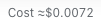
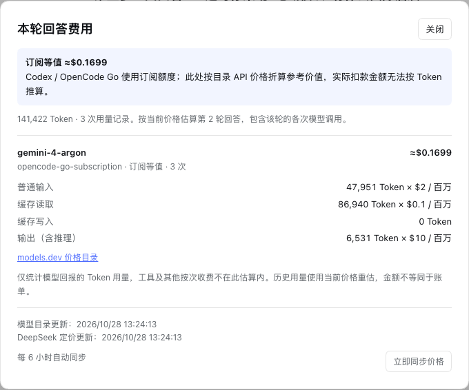

# Cost for DeepSeek Harness

[](https://github.com/solstice621/dsh-conversation-cost/actions/workflows/ci.yml)
[](LICENSE)

在 DeepSeek Harness 桌面版中查看**每轮回答费用**与**当前会话累计费用**。自动读取模型价格，常驻界面只显示 `Cost ≈$x`，点击再看单价与用量明细。

独立社区插件，包名 **`dsh-conversation-cost`**。无需新增 API key，无运行时 npm 依赖，不修改 App 或 asar，可独立停用、卸载。

## 显示效果

每轮回答结束后，顺序为 **用量 → Cost → 时间**：


输入框下方显示整个会话的累计金额：



点击任一 Cost，查看对应范围的模型、四类 Token、单价和价格来源：



截图仅包含插件界面，未包含对话正文或账号信息。

## 安装

已验证 **macOS + DeepSeek Harness Desktop `0.2.1-rc.3`**。其他宿主版本和操作系统尚未完成桌面验证；当前宿主版本声明为 `>=0.2.1-rc.3 <0.3.0-0`。

1. 在 Harness 左侧打开「插件」→「添加插件」。
2. 填写以下地址，安装并启用：

   ```text
   github:solstice621/dsh-conversation-cost#v0.1.5
   ```

3. 若当前窗口尚未出现 Cost，刷新 Harness 界面；仍未出现时完全退出并重新打开。
4. 打开一个已有会话，即可看到累计费用和已完成回答的逐轮费用，无需为验证功能重新发送模型请求。

如需跟随开发分支，可将 `#v0.1.5` 换成 `#main`。插件直接提供可运行的 JavaScript，无需构建或执行第三方安装脚本。

本地打包、CLI 安装、更新与卸载步骤见 **[安装说明](docs/INSTALL.md)**。

## 功能

| 功能 | 行为 |
| --- | --- |
| 每轮回答费用 | 汇总该轮已记录的各次模型调用，不混入其他轮次；费用位于用量后、时间前 |
| 会话累计费用 | 输入框下方显示当前会话自己的累计金额，不重复计入 fork 继承的上下文 |
| 简洁标签 | 只显示 `Cost ≈$x`；全部缺价或尚未读到数据时显示 `Cost ≈—` |
| 费用明细 | 点击后查看模型、普通输入、缓存读取、缓存写入、输出和对应单价 |
| 自动价格同步 | 启动读取，随后每 6 小时刷新；明细中也可手动同步 |
| 离线回退 | 同步失败保留最近成功的缓存；首次离线使用随包公共价格快照 |
| 多模型与分档 | 每次调用采用自己的模型与价格，上下文档位按该次完整输入选择 |
| 共用请求 | 同一会话的回答标记与累计费用共享读取结果，不为每条回答单独创建轮询 |

## 价格从哪里来

| 渠道 | 价格来源与匹配规则 |
| --- | --- |
| `deepseek`、`deepseek-official`、`deepseek-account` | [DeepSeek 官方定价页](https://api-docs.deepseek.com/quick_start/pricing/)，按调用时间应用峰谷、周末和中国节假日规则 |
| 其他 API 渠道 | [models.dev 公共目录](https://models.dev/api.json)，精确匹配 `provider/model`；不会因模型名相似而借用其他渠道的价格 |
| `codex-subscription`、`openai-codex` | 使用 models.dev 中同模型的 OpenAI API 价格计算订阅参考价值 |
| `opencode-go-subscription`、`opencode-go` | 优先读取 models.dev 的 Go 同模型价格；缺价时仅可使用 OpenCode Zen **相同模型 ID** 的 API 参考价，并在明细中注明参考路由 |

支持独立安装，也可搭配 [OpenAI / Codex Auth](https://github.com/solstice621/dsh-openai-auth) 和 [OpenCode Go Auth](https://github.com/solstice621/dsh-opencode-go-auth)。本插件不依赖它们的授权流程，也不负责登录或查询订阅额度。

## 金额如何计算

以每百万 Token 的单价计算每条用量记录，再汇总到对应回答和会话：

```text
金额 =（普通输入 × 输入单价
      + 缓存读取 × 读取单价
      + 缓存写入 × 写入单价
      + 输出 × 输出单价）/ 1,000,000
```

推理 Token 已包含在输出中，不重复相加。分档依据该次请求的普通输入、缓存读取和缓存写入之和。单次金额保留计算精度，最终显示四位小数；极小的正数显示小于 `$0.0001`。

金额统一为 **美元 USD**，不进行汇率换算。常驻标签合计 API 估算与订阅等值，明细将两者分开。**订阅等值是 API 价格折算的参考价值，不代表订阅实际扣款。**

### 统计范围

- 使用原始日志中 `assistant/message` 回报的有效 `usage`；优先采用消息的真实 provider/model，缺失时使用请求头。
- 会话金额只计本会话自己的记录，不合并子会话，不重复计入 fork 继承的历史。
- 每轮金额包含该轮中已记录的各次助手调用；分页和折叠不会把累计金额截断成屏幕上可见的部分。
- 缺失单价或用量会在明细标出覆盖缺口；部分缺价时标签只合计可计算的金额，全部缺价时显示 `Cost ≈—`。
- 工具按次费用、会话标题等辅助调用，以及没有形成有效助手用量记录的失败尝试不保证纳入。
- 历史用量使用**当前价格重估**；价格更新可能改变旧会话的估算，本插件不保存历次账单或历史价格版本。

因此，这个金额适合查看用量对应的成本量级，不是平台账单。

## 数据与网络

会话用量通过宿主的 `sessionQuery` 按需读取，只在进程内缓存计数、模型标识与时间，不保存对话正文副本。价格缓存以原子替换方式写入：

```text
<DSH_HOME>/cache/dsh-conversation-cost/prices.json
```

无需读取账号凭据，不修改授权插件、默认模型或原有 Token 统计。出站请求仅用于读取 models.dev、DeepSeek 官方定价页，以及按需读取的 [holiday-cn](https://github.com/NateScarlet/holiday-cn) 年度日历，不上传对话、用量或凭据。随包快照目前含 2026 年日历；没有可用日历的年份不会猜测 DeepSeek 峰谷价。

宿主接口沿用原生 `connection.fetch` 的认证与 Host/Origin 检查：

- `GET /api/conversation-cost?sessionId=…`：会话总计、各轮总计和价格更新时间。
- `POST /api/conversation-cost/prices/refresh`：刷新公共价格。

## 常见问题

**为什么显示 `Cost ≈—`？**

可能正在读取、该模型尚未收录价格，或上游没有回报有效用量。点击 Cost 查看明细；网络恢复后可点击「立即同步价格」。缺价不会当成免费。

**为什么模型和插件都升级了，旧回答的 ID 仍然不同？**

历史记录保留当时调用的模型。Go 缺少旧 ID 时会尝试同名 Zen API 参考价，但不会把旧模型当成新版本计价；参考路由会明确显示。

**能否修改币种或隐藏某个 Cost？**

当前版本固定显示美元，同时提供逐轮和会话累计两个入口，尚未提供额外显示设置。

## 开发与验证

```sh
git clone https://github.com/solstice621/dsh-conversation-cost.git
cd dsh-conversation-cost
npm ci --ignore-scripts
npm test
npm run check
```

测试无需真实账号或付费模型请求。CI 在 Node.js 20、22、24 上运行单元测试与包检查；桌面验证记录、覆盖边界和目录结构见 [测试说明](docs/TESTING.md)。

## License

[MIT](LICENSE)。随包公共价格和节假日数据的来源与许可见 [第三方声明](THIRD_PARTY_NOTICES.md)。
